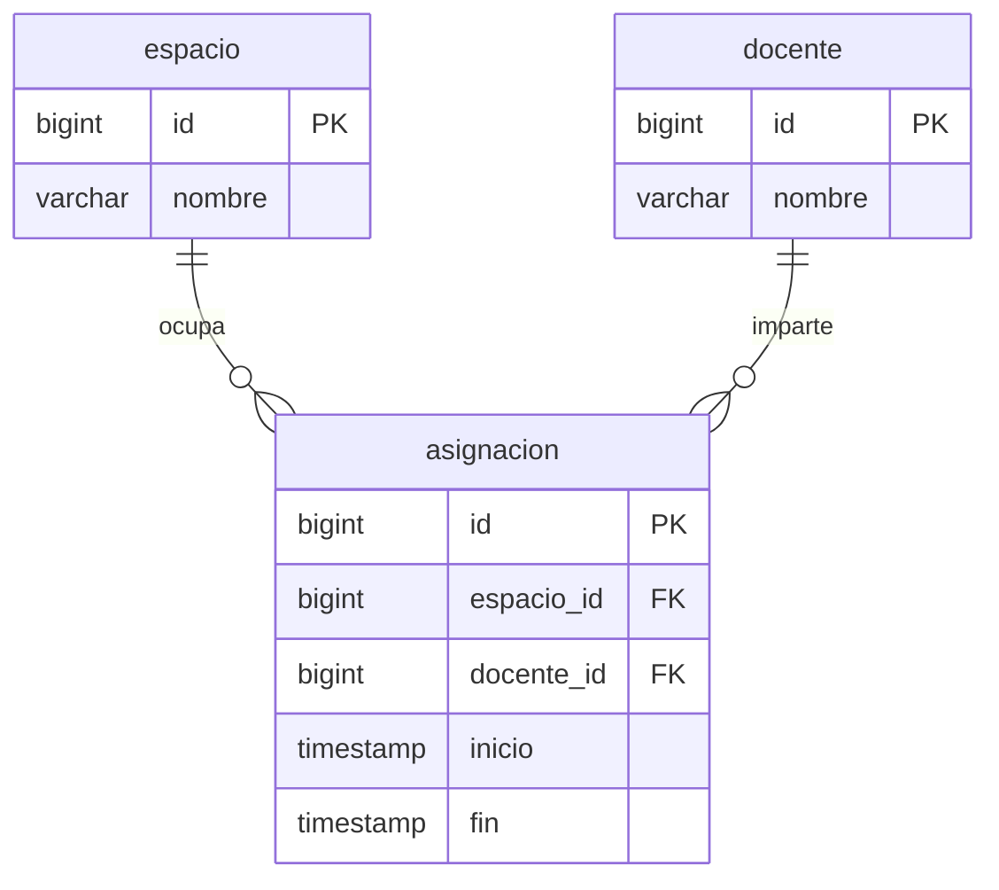

# 1. Alcance y fuente

Implementacion de persistencia y Flyway para el control de cruces de AulaIA.
`DOCUMENTACION_TECNICA.md` contiene el encargo de elaborar el diseno, pero no
las secciones 6.2.1/6.2.2 ni un plan previo de entidades. El siguiente modelo es
una propuesta minima basada en la solicitud actual; no se presenta como un
diseno recuperado del documento. Los nombres exigidos `no_cruce_espacio`,
`no_cruce_docente` y `V1__esquema_inicial.sql` se conservan literalmente.

## 2. Preguntas abiertas y supuestos propuestos

| Informacion pendiente | Supuesto utilizado |
| --- | --- |
| Diseno 6.2.1 y 6.2.2 y sus nombres exactos | Modelo minimo en espanol: Espacio, Docente y Asignacion. Pendiente cotejar con el diseno fuente. |
| Nombre de una base nueva | Se utiliza `postgres`, la base existente de la URL solicitada; no se elimina ni recrea. |
| Zona horaria y tipo temporal | Horario local de la sede con `LocalDateTime`, `timestamp without time zone` y `tsrange`. |
| Atributos de capacidad, materiales y condiciones fisicas | Pendientes del diseno; no se agregan columnas ni reglas sin definicion. |
| Recurrencia y cancelaciones | Cada asignacion es un intervalo concreto; no se inventan estados ni excepciones a los cruces. |
| Version del servidor local | `localhost:5432` responde PostgreSQL 18.6. El SQL utiliza funciones disponibles en PostgreSQL 16; las pruebas tambien se ejecutan en una instancia 16 aislada. |

## 3. Plan de desarrollo ejecutable

1. Agregar JPA, el starter Flyway, su modulo PostgreSQL y el controlador JDBC.
2. Configurar la conexion indicada y la contrasena por `AULA_DB_PASSWORD`.
3. Versionar el esquema en `src/main/resources/db/migration/V1__esquema_inicial.sql`.
4. Mapear entidades y repositorios. Flyway administra el DDL; Hibernate valida los mapeos con `ddl-auto=validate`.
5. Migrar mediante el arranque de Spring Boot y comprobar el historial Flyway.
6. Verificar cruces, limites, integridad, actualizaciones y concurrencia contra PostgreSQL real, en un esquema de pruebas aislado.

## 6.2.1. Modelo de entidades propuesto

| Entidad / tabla | Atributos | Relaciones |
| --- | --- | --- |
| `Espacio` / `espacio` | `id`: Long/BIGINT identity; `nombre`: String/VARCHAR(255), obligatorio | Referenciado por asignaciones |
| `Docente` / `docente` | `id`: Long/BIGINT identity; `nombre`: String/VARCHAR(255), obligatorio | Referenciado por asignaciones |
| `Asignacion` / `asignacion` | `id`: Long/BIGINT identity; `espacio_id`, `docente_id`: BIGINT; `inicio`, `fin`: timestamp without time zone, todos obligatorios | Muchos a uno a Espacio y Docente, carga diferida |

Los repositorios `EspacioRepository`, `DocenteRepository` y
`AsignacionRepository` extienden `JpaRepository`.

## 6.2.2. Modelo de datos propuesto

`btree_gist` se instala en `public` para combinar igualdad de identificadores
con solapamiento de rangos. Las tablas se crean en el esquema de Flyway.

| Restriccion | Regla |
| --- | --- |
| `pk_espacio`, `pk_docente`, `pk_asignacion` | Claves primarias de identidad |
| `fk_asignacion_espacio`, `fk_asignacion_docente` | Referencias obligatorias, sin borrado en cascada |
| `intervalo_valido` | `CHECK (inicio < fin)` |
| `no_cruce_espacio` | `EXCLUDE USING gist (espacio_id WITH =, tsrange(inicio, fin, '[)') WITH &&)` |
| `no_cruce_docente` | `EXCLUDE USING gist (docente_id WITH =, tsrange(inicio, fin, '[)') WITH &&)` |

Ambas exclusiones protegen INSERT y UPDATE, incluso entre transacciones
concurrentes. El limite superior excluido permite bloques consecutivos.



## 7. Ejecucion

Requiere JDK 21 y PostgreSQL accesible. La aplicacion carga automaticamente
`.env` desde el directorio de trabajo. Para otra instalacion, copiar
`.env.example` como `.env` y completar `AULA_DB_URL`, `AULA_DB_USER` y
`AULA_DB_PASSWORD`. Consultar la [configuracion de .env](CONFIGURACION_ENV.md).

Desde IntelliJ, ejecutar `AulaAssistentApiApplication` con el directorio de
trabajo en la raiz del proyecto. Desde PowerShell en esa misma raiz:

```powershell
.\gradlew.bat bootRun --console=plain
```

Como alternativa, configurar la contrasena en el entorno del proceso. Una
variable `AULA_DB_PASSWORD` ya definida tiene prioridad sobre `.env`:

```powershell
$env:AULA_DB_PASSWORD = [System.Net.NetworkCredential]::new('', (Read-Host 'Contrasena PostgreSQL' -AsSecureString)).Password
.\gradlew.bat bootRun --console=plain
```

Por defecto se usa `jdbc:postgresql://localhost:5432/postgres`, usuario
`postgres`. Se pueden cambiar con `AULA_DB_URL` y `AULA_DB_USER`. La contrasena
se puede configurar en `.env` (ignorado por Git) o en el entorno. Las propiedades
existentes en `application.properties` se conservan como respaldo. La base destino debe existir: Flyway crea
tablas y mantiene `flyway_schema_history`, no crea la base de conexion.
El arranque aplica V1 una sola vez; los siguientes validan su checksum.
Despues de aplicar V1, cualquier cambio de esquema debe ir en una migracion
nueva, sin modificar la V1 aplicada.

```powershell
.\gradlew.bat test --console=plain
```

Las pruebas crean un esquema con nombre aleatorio y lo eliminan al finalizar;
no usan las tablas de negocio de `public`. La extension compartida
`btree_gist` puede permanecer instalada. Para ejecutar contra otra instancia,
definir `AULA_DB_URL` antes del comando. El usuario de pruebas necesita crear
esquemas e instalar la extension si aun no existe.

Las pruebas de integracion tambien leen `.env`; no requieren exportar
`AULA_DB_PASSWORD` manualmente cuando el archivo esta configurado.

La verificacion SQL independiente se ejecuta con `psql` conectado a la base
migrada y `-v ON_ERROR_STOP=1 -f scripts/verificar_cruces.sql`. Comprueba por
separado ambos errores `23P01`, acepta 10-11 despues de 08-10 y rechaza un
intervalo vacio con `23514`. Revierte las filas de prueba; las secuencias
pueden avanzar.

## 8. Referencias tecnicas

- [Rangos y exclusiones en PostgreSQL 16](https://www.postgresql.org/docs/16/rangetypes.html#RANGETYPES-CONSTRAINT).
- [Extension btree_gist de PostgreSQL 16](https://www.postgresql.org/docs/16/btree-gist.html).
- [Inicializacion con Flyway en Spring Boot](https://docs.spring.io/spring-boot/how-to/data-initialization.html#howto.data-initialization.migration-tool.flyway).

## 9. Resultado de la verificacion (2026-10-25)

| Entorno | Resultado |
| --- | --- |
| PostgreSQL 16.15, contenedor temporal aislado | 11 pruebas, 0 fallos, 0 errores, 0 omitidas |
| PostgreSQL 18.6, `localhost:5432/postgres` | 11 pruebas, 0 fallos, 0 errores, 0 omitidas |
| Flyway en `postgres.public` | V1 aplicada correctamente; segundo arranque valida y confirma que no hay migraciones pendientes |
| SQL independiente en la base indicada | `no_cruce_espacio`: 23P01; `no_cruce_docente`: 23P01; consecutivos permitidos; intervalo vacio: 23514 |

Las pruebas incluyen persistencia JPA, cruces en INSERT y UPDATE, duplicados,
inicio igual o posterior a fin, recursos inexistentes, fechas nulas y dos
transacciones concurrentes. El esquema de pruebas se elimina al finalizar.
La instancia temporal de PostgreSQL 16 fue detenida y eliminada despues de
validar. La base local conserva V1 y las tres tablas vacias.

## 10. Fase siguiente implementada: API REST

Se agregaron controladores, DTO, mapeadores, servicios transaccionales y manejo
de errores para espacios, docentes y asignaciones. El contrato, filtros,
ejemplos, ejecucion y resultados de las 40 pruebas estan en
[API_REST.md](API_REST.md). La migracion V1 permanece aplicada sin cambios.
